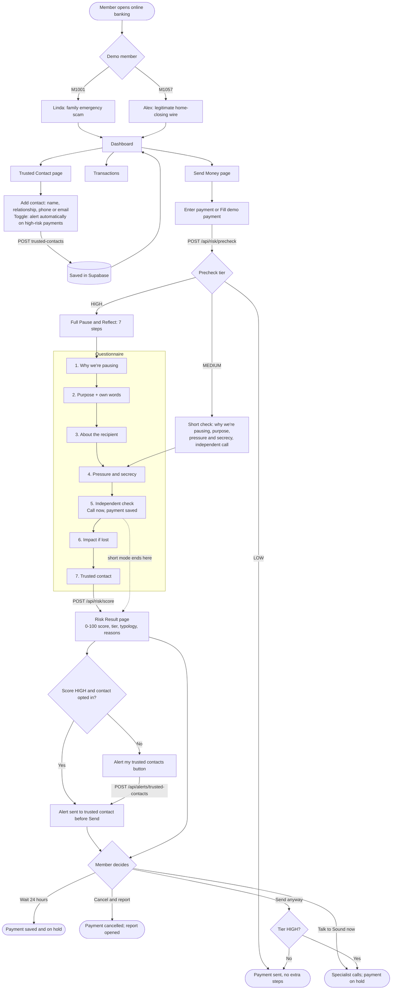
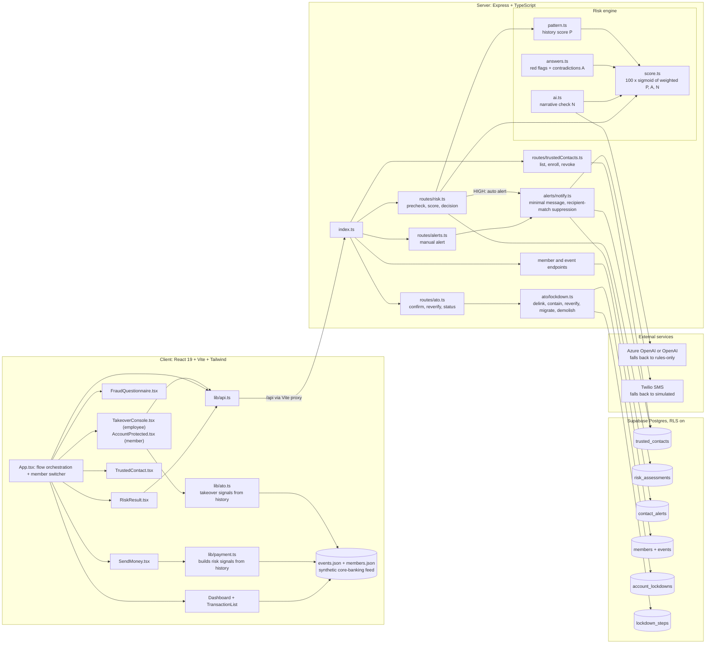
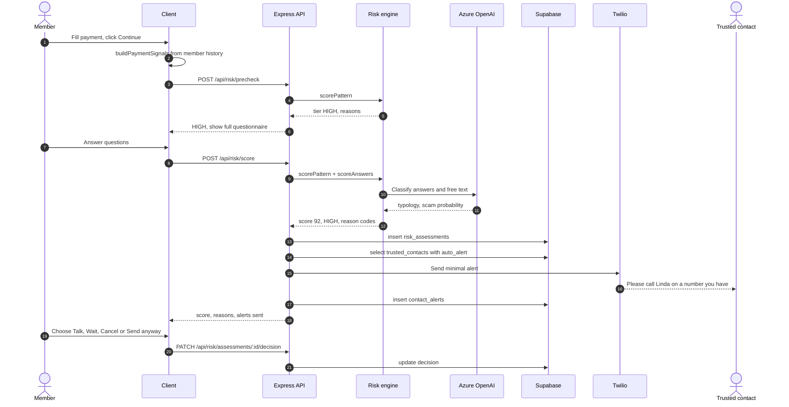
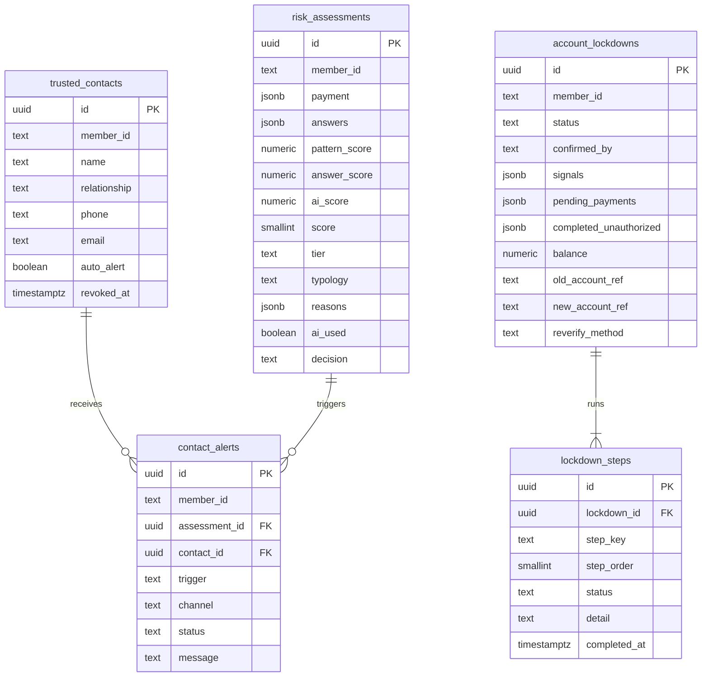
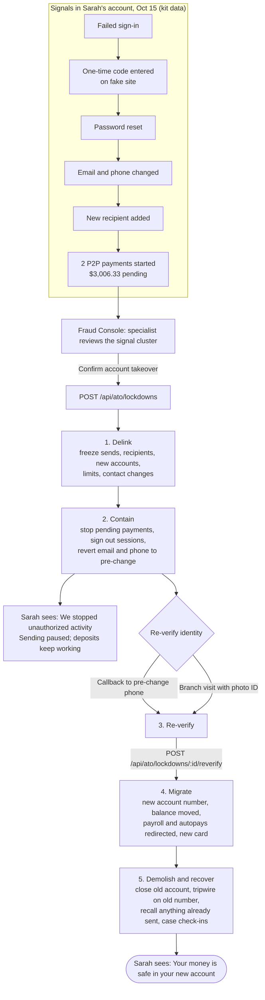
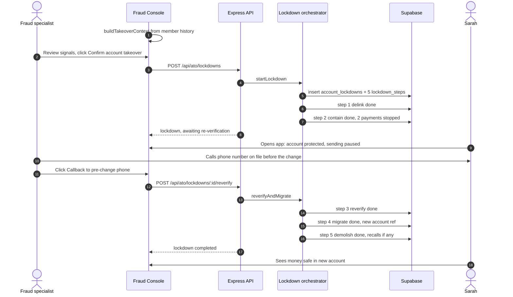

# Anchor diagrams

## 1. User UI flow

## 2. System architecture

## 3. Request sequence: risk score and trusted-contact alert

## 4. Supabase data model

## 5. Account takeover: post-confirmation lockdown flow

## 6. Account takeover: request sequence

